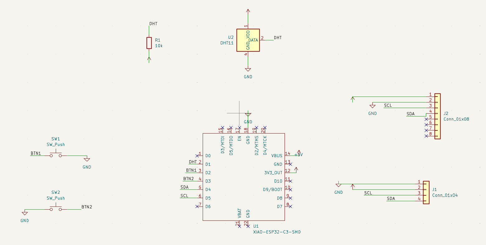

# Starbie

A small star-shaped PCB desk pet built around a XIAO ESP32-C3, with an OLED screen, a motion sensor and a temperature sensor.

## Why I made it
I made it as the week 1 project of half life hack club and I picked Starbie because it’s a small, fun project that combines a screen, sensors and buttons on one board. It was a great way to learn KiCad as a beginner using the guide :)

## How it works
The XIAO ESP32-C3 is the brain. It draws the pet on the OLED screen, reads the MPU6050 so the pet reacts when the board is tilted or shaken, reads the DHT11 for temperature and humidity, and reads two buttons for input.

## How the parts fit together
- **XIAO ESP32-C3 (U1):** the microcontroller. It powers everything from its 3V3 pin and GND.
- **OLED display (J1, 4-pin header):** pin 1 GND, pin 2 3.3V, pin 3 SCL (D5), pin 4 SDA (D4)
- **MPU6050 module (J2, 8-pin header):** pin 1 3.3V, pin 2 GND, pin 3 SCL (D5), pin 4 SDA (D4). It shares the I2C lines with the OLED. Pins 5 to 8 are unused.
- **DHT11 (U2):** data pin to D1. A 10k pull-up resistor (R1) connects the data line to 3.3V.
- **Button 1 (SW1):** connects D2 to GND
- **Button 2 (SW2):** connects D3 to GND
  
## Firmware Credits
The firmware used in this project is based on the original Starbie firmware provided by SharKingStudios in the Hack Club Half-Life guide.
Original firmware: https://github.com/SharKingStudios/Starbie/tree/main/Firmware
The original firmware is licensed under the MIT License, Copyright (c) 2026 Logan Peterson. The license text is included in this repository.
I followed the official guide for the firmware rather than generating it with AI.

## Bill of Materials (BOM)

| Part | What it does | Qty | Unit price | Total | Vendor | Link |
|------|--------------|-----|-----------|-------|--------|------|
| XIAO ESP32-C3 | The main chip | 1 | $4.90 | $4.90 | Seeed Studio | [Buy](https://www.seeedstudio.com/Seeed-XIAO-ESP32C3-p-5431.html) |
| 0.96 inch OLED display (I2C) | Screen that shows the pet | 1 | $3.76 | $3.76 | Daraz | [Buy](https://tinyurl.com/9mjyudrn) |
| DHT11 | Temperature and humidity sensor | 1 | $2.90 | $2.90 | Daraz | [Buy](https://tinyurl.com/9fm7tvjk) |
| 10k resistor (pack of 10) | Pull-up resistor on the DHT11 data line | 1 | $0.42 | $0.42 | Daraz | [Buy](https://www.daraz.pk//products/i465392816-s2198965661.html?spm=a2o42.cart.0.0.22717d68aTIudk&urlFlag=true) |
| Custom PCB (Starbie) | The circuit board, made from my Gerber files | 1 | $6.44 | $6.44 | PCBX | [Buy](https://www.pcbx.com/order/manufacturing/pcb) |
| MPU6050 module | Motion sensor that detects tilting and shaking | 1 | $1.81 | $1.81 | Daraz | [Buy](https://tinyurl.com/fe83xnmz) |
| Tactile push buttons 6x6x5mm | The 2 buttons on the board | 1 | $1.08 | $1.08 | Daraz | [Buy](https://tinyurl.com/4ehe2pe8) |
| Tax & shipping | For the whole order | - | - | $7.40 | - | - |
| **Total** | | | | **$28.71** | | |
  
## Schematic

## PCB layout

## 3D model

## Repo files
- `PCB/` KiCad project files
- `production/` Gerber and drill files
- `Firmware/` Arduino code
- `Assets/` images
- `BOM.csv` parts list
